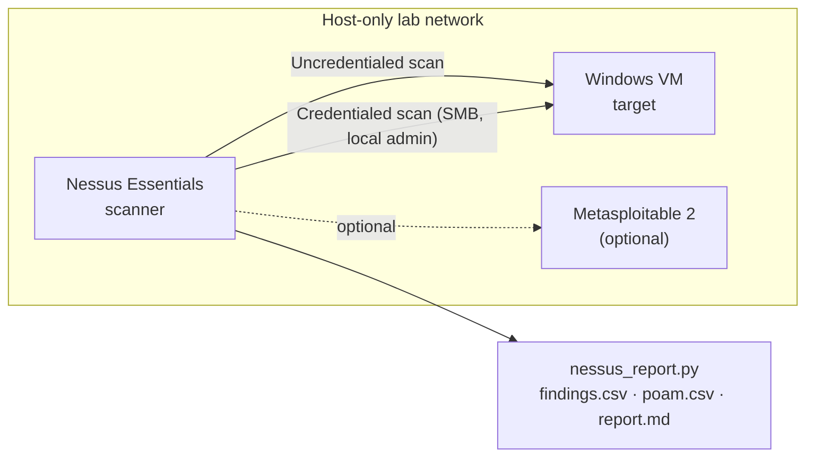

# Nessus Vulnerability Management Lab

End-to-end vulnerability management lab built on **Tenable Nessus Essentials**: scan → analyze → prioritize by risk → report → track in a POA&M → remediate → validate with a rescan.

This lab is about how a **Cyber Risk Analyst** works: running a scanner is the easy part. The hard part is turning raw scan output into risk-ranked findings that leadership and system owners can act on, mapped to **NIST SP 800-53** controls and tracked to closure.


---

## Lab Architecture



| Component | Role |
|---|---|
| Nessus Essentials (free, 16 IPs) | Vulnerability scanner |
| **Windows VM** | Documented target: deliberately left unpatched with outdated apps, SMBv1, and RDP without NLA |
| Metasploitable 2 *(optional)* | Extra Linux target. Setup instructions included for anyone extending the lab |
| `scripts/nessus_report.py` | Parses `.nessus` exports into risk-scored findings, a POA&M, and reports |

## Vulnerability Management Lifecycle

| Phase | What I did | Artifact |
|---|---|---|
| 1. Asset inventory | Defined in-scope asset, owners, and criticality | [`assets.example.csv`](assets.example.csv) |
| 2. Discovery | Host discovery scan to confirm live hosts | [docs/02](docs/02-scan-policies.md) |
| 3. Assessment | Uncredentialed vs. credentialed Basic Network Scans | [docs/03](docs/03-scan-execution.md) |
| 4. Analysis & prioritization | Validated findings, removed false positives, scored by contextual risk (CVSS/VPR + asset criticality + exploitability + CISA KEV) | [docs/04](docs/04-risk-analysis-methodology.md) |
| 5. Reporting | Executive summary + technical report | [`reports/`](reports/) |
| 6. Tracking | POA&M with NIST 800-53 controls, owners, SLA due dates | `poam.csv` |
| 7. Remediation & validation | Fixed top findings, rescanned, measured risk reduction | [docs/05](docs/05-remediation-and-validation.md) |

## Results (Windows VM)

> 📌 Filled in from my own scans (`scans/`, `reports/`).

| Metric | Baseline | After remediation |
|---|---:|---:|
| Critical | _TBD_ | _TBD_ |
| High | _TBD_ | _TBD_ |
| Medium | _TBD_ | _TBD_ |
| Low | _TBD_ | _TBD_ |
| Findings: uncredentialed vs. credentialed | _TBD_ vs _TBD_ | n/a |
| Aggregate risk score | _TBD_ | _TBD_ |

**Key takeaways:** _TBD_

### Evidence
Full screenshot index: [`screenshots/`](screenshots/). Highlights:

| Credentialed check verified | Baseline scan | After remediation |
|---|---|---|
| _07-credentialed-checks-yes.png_ | _10-credentialed-summary.png_ | _14-rescan-summary.png_ |

## Reporting Toolkit (`nessus_report.py`)

Pure-Python (standard library only) tool that turns Nessus `.nessus` exports into analyst deliverables.

```bash
# Risk-scored report + findings CSV + POA&M
python3 scripts/nessus_report.py report scans/baseline.nessus -o reports/baseline \
    --assets assets.example.csv --kev known_exploited_vulnerabilities.csv

# Remediation validation (baseline vs rescan)
python3 scripts/nessus_report.py diff scans/baseline.nessus scans/rescan.nessus -o reports/validation
```

| Output | Audience | Contents |
|---|---|---|
| `report.md` | Leadership + system owners | Executive summary, risk by host, top 10, detailed Critical/High findings with evidence |
| `findings.csv` | Analysts | Every finding with CVSS, VPR, exploit, KEV, and contextual risk score |
| `poam.csv` | ISSO / ISSM / AO | One POA&M item per weakness: 800-53 controls, affected assets, POC, milestones, SLA due date |
| `remediation_validation.md` | Everyone | Remediated / persisting / new findings and % risk reduction |

**Contextual risk scoring:** best available technical score (VPR → CVSSv3 → CVSSv2), adjusted for asset criticality (±1.0), public exploit (+0.5), and CISA KEV listing (+1.5). Context can move a rating at most one level from the Nessus severity, and KEV findings are never below High. Full reasoning is in [docs/04](docs/04-risk-analysis-methodology.md).

👉 See [`sample-output/`](sample-output/) for example output generated from **synthetic test data** (`tests/fixtures/`, not a real scan).

Run tests: `python3 -m unittest discover -s tests -v`

## Repository Layout

```
├── docs/
│   ├── 01-lab-setup.md                 # VMs, network isolation, Nessus install
│   ├── 02-scan-policies.md             # Discovery, basic, credentialed policies
│   ├── 03-scan-execution.md            # Running scans, credentialed vs uncredentialed
│   ├── 04-risk-analysis-methodology.md # Validation, CVSS vs VPR, prioritization, SLAs
│   ├── 05-remediation-and-validation.md
│   └── 06-key-concepts.md              # RMF, RA-5, POA&M, ACAS, risk responses
├── reports/templates/                  # Exec summary, finding write-up, risk acceptance
├── scripts/nessus_report.py            # Parser / risk scoring / POA&M / diff
├── scans/                              # Your exported .nessus files (lab only)
├── sample-output/                      # Example output from synthetic data
└── tests/                              # Unit tests + synthetic fixtures
```

## Frameworks Referenced
- **NIST SP 800-53 Rev. 5**: RA-5 (Vulnerability Monitoring & Scanning), SI-2 (Flaw Remediation), CA-5 (POA&M), CA-7 (Continuous Monitoring), CM-6/CM-7 (Configuration / Least Functionality)
- **NIST SP 800-37 Rev. 2**: Risk Management Framework
- **NIST SP 800-30 Rev. 1**: Guide for Conducting Risk Assessments
- **NIST SP 800-40 Rev. 4**: Enterprise Patch Management Planning
- **CISA BOD 22-01 / KEV catalog**, **CVSS v3.1**, **Tenable VPR**

## ⚠️ Ethics & Scope
All scanning was done against a VM I own, on an isolated host-only network. Never scan systems you are not explicitly authorized to test. Do not commit scans of real organizational networks to a public repository.
